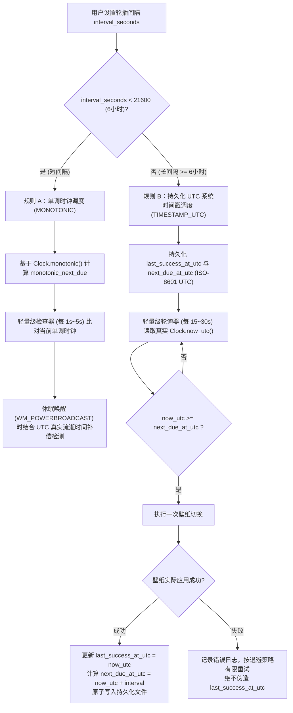

# 壁纸轮播双模式调度系统设计文档 (`scheduler_design.md`)

## 一、背景与痛点分析

传统的桌面壁纸轮播软件通常仅使用单一的内存计时器（例如 `QTimer.start(interval_ms)`、`threading.Timer` 或异步 `sleep(interval_seconds)`）来实现定时切换。这种简单设计在实际桌面环境中存在以下严重缺陷：

1. **长间隔失效与漂移**：当用户将切换间隔设置为 6 小时、12 小时或 24 小时时，内存计时器极易受到系统睡眠/休眠（挂起期间计时器暂停或行为不一致）的影响，导致唤醒后长时间不切换。
2. **程序重启丢失进度**：若用户设置了每 12 小时切换一次，程序运行了 10 小时后重启电脑或退出重开，传统内存计时器会从头重新倒计时 12 小时，导致连续 22 小时无法切换壁纸。
3. **系统时间/时区调整异常**：若依赖未经校验的本地时间字符串或简单计时器，在 NTP 校时、夏令时切换或手动修改系统时间后容易发生跳过或卡死。
4. **切换失败假成功**：许多程序在计时器触发瞬间即重置倒计时，若此时磁盘未就绪、图片损坏或 Windows API 暂时调用失败，会导致该周期壁纸未更换却进入下一个漫长周期。

为彻底解决上述工程痛点，**WallFlow** 设计并实现了**基于 `21600 秒（6 小时）` 阈值的双模式混合调度架构**。

---

## 二、为什么采用两种调度策略（阈值：6 小时 = 21600 秒）



### 2.1 规则 A：短间隔调度（`interval_seconds < 21600`）
- **适用场景**：几秒、几分钟到几小时内的频繁轮播（如每 5 分钟、30 分钟、2 小时切换一次）。
- **为什么采用单调时钟（`time.monotonic()`）**：
  - 短间隔轮播追求相对时间间隔的精确性与低开销。单调时钟不会因为系统 NTP 自动校时或用户手动微调系统时钟而发生回跳或突进。
  - 同时，为了解决电脑睡眠/休眠期间 `time.monotonic()` 可能停止累加或跳变的问题，我们在每次切换时同步记录最近一次切换的 UTC 时间 `last_success_at_utc`，并在收到 `WM_POWERBROADCAST`（休眠恢复）事件或检测到两次检查之间的真实 UTC 时间跨度超过 `interval_seconds` 时，立即触发一次补偿切换。
  - **非阻塞设计**：绝不在主线程或工作线程中使用长时间 `time.sleep()`，而是通过短周期（默认 1 秒）心跳检查 `clock.monotonic() >= monotonic_next_due`，确保 UI 响应、暂停/恢复与间隔修改即时生效。

### 2.2 规则 B：长间隔调度（`interval_seconds >= 21600`，即 6 小时及以上）
- **适用场景**：6 小时、12 小时、24 小时（每日一图）或数天一次的长周期轮播。
- **为什么必须采用持久化 UTC 系统时间戳**：
  - 在 6 小时以上的长周期内，电脑极有可能经历**关机、重启、睡眠、休眠、注销重登或程序重启**。任何仅驻留内存的计时器在进程退出后都会彻底丢失状态。
  - 采用带时区的 **UTC 绝对时间戳**（如 `2026-10-29T13:00:00+00:00`）持久化到磁盘后：
    1. 无论程序何时重启、休眠多久，只需读取当前真实系统 UTC 时间 `now_utc = clock.now_utc()` 并与磁盘上持久化的 `next_due_at_utc` 比较：`now_utc >= next_due_at_utc`。
    2. 彻底消除了跨时区迁移、夏令时切换或无时区本地时间字符串解析歧义。
    3. 轻量级轮询器每 15~30 秒唤醒一次读取 `clock.now_utc()`，**绝不通过累加轮询次数来推算时间**，因此即使 CPU 负载极高、GUI 暂时繁忙或系统挂起数小时，时间判断依然 100% 准确。

---

## 三、持久化数据结构与原子写入机制

调度状态保存在 `%LOCALAPPDATA%\WallFlow\config.json`（及独立的调度快照备份）中，关键字段如下：

```json
{
  "scheduler": {
    "enabled": true,
    "paused": false,
    "interval_seconds": 21600,
    "scheduler_mode": "timestamp_utc",
    "last_success_at_utc": "2026-10-29T12:00:00+00:00",
    "next_due_at_utc": "2026-10-29T18:00:00+00:00",
    "consecutive_failures": 0,
    "last_error": "",
    "last_check_at_utc": "2026-10-29T13:05:00+00:00"
  }
}
```

### 3.1 原子持久化保证
1. **写临时文件 + 校验 + 原子替换**：
   每次保存配置或调度状态时，先序列化为 JSON 字符串并校验 JSON 可解析性，写入同目录下的临时文件 `config.json.<pid>.tmp`，执行 `flush()` 与 `os.fsync()` 确保落盘，随后调用 `os.replace(tmp_path, target_path)` 进行操作系统级原子替换，同时维护一份 `config.json.bak` 备份。
2. **真实成功后才更新时间戳**：
   只有当 `wallpaper_manager.apply_wallpaper()` 返回 `True`（图片成功解码且 Windows API 调用返回成功）后，调度器才会更新 `last_success_at_utc = now_utc` 与 `next_due_at_utc = now_utc + timedelta(seconds=interval_seconds)`。

---

## 四、开机、休眠、时间跳变与异常恢复机制

### 4.1 程序启动与重启恢复 (`on_startup_check`)
- **计划时间未到（`now_utc < next_due_at_utc`）**：
  保持已持久化的 `next_due_at_utc` 不变，继续等待该时间点到来（不会因为重启而重置 6/12/24 小时倒计时）。
- **计划时间已过（`now_utc >= next_due_at_utc`）**：
  立即执行**且仅执行一次**补偿切换（Compensatory Switch），绝不把关机/休眠期间错过的 N 个周期连续闪屏播放 N 次。补偿切换成功后，从本次实际完成时间 `now_utc` 重新计算 `next_due_at_utc = now_utc + interval_seconds`。

### 4.2 系统睡眠/休眠恢复 (`on_system_resume`)
- 监听 Windows `WM_POWERBROADCAST` 消息（`PBT_APMRESUMEAUTOMATIC` / `PBT_APMRESUMESUSPEND`）及 `WM_WTSSESSION_CHANGE`（`WTS_SESSION_UNLOCK`）。
- 收到唤醒信号后，立即调用 `check_now(reason="system_resume")`：
  - 在长间隔模式下，直接读取当前 `clock.now_utc()` 与 `next_due_at_utc` 对比；若已到期则立即补偿切换。
  - 在短间隔模式下，同时检查单调时钟差值与 `now_utc - last_success_at_utc`；若休眠时长已达到或超过 `interval_seconds`，立即执行一次补偿切换并重置单调时钟基准。

### 4.3 系统时间或时区变更 (`on_time_change`)
- 监听 `WM_TIMECHANGE` 消息，并在每次轮询时检测系统时钟是否发生异常大幅回拨（例如系统时间被人为往回调整，导致 `next_due_at_utc - now_utc > interval_seconds * 1.1`）。
- 若检测到系统时间被向后推进且已越过 `next_due_at_utc`，立即触发补偿切换；若检测到系统时间被大幅回拨导致 `next_due_at_utc` 距离当前时间超过一个完整周期（`> interval_seconds`），则自动将 `next_due_at_utc` 重新校准为 `now_utc + interval_seconds`，防止因时钟回拨导致数月不切换。

### 4.4 切换失败后的有限退避重试
- 当某张图片损坏或 Windows 壁纸 API 临时失败时：
  1. 捕获异常并记录详细错误到 `%LOCALAPPDATA%\WallFlow\logs\wallflow.log` 及调度器的 `last_error` 状态。
  2. 尝试通知 `image_library` / `random_selector` 跳过不可用图片并抽取下一张候选图进行有限次数重试（默认单次触发内最多尝试 3 张候选图）。
  3. 若全部尝试仍失败，递增 `consecutive_failures`，设置退避冷却时间 `retry_after_utc = now_utc + min(300, 15 * 2^(failures-1))` 秒，**绝不伪造 `last_success_at_utc`**，也绝不陷入无间隔死循环重试。

---

## 五、可测试的时间抽象设计 (`Clock` 接口)

为了在不实际等待 6~24 小时的前提下对全部调度场景进行 100% 确定性验证，我们在 `app/clock.py` 中定义了 `Clock` 抽象接口：

```python
class Clock(Protocol):
    def now_utc(self) -> datetime:
        """返回带 UTC 时区的当前系统时间 (datetime.now(timezone.utc))"""
        ...

    def monotonic(self) -> float:
        """返回单调递增时钟秒数 (time.monotonic())"""
        ...
```

- **生产环境**：使用 `SystemClock`，直接调用 `datetime.now(timezone.utc)` 与 `time.monotonic()`。
- **测试环境**：使用 `VirtualClock`（虚拟时钟），支持：
  - `advance(seconds)`：同时推进 UTC 时间与单调时钟。
  - `simulate_sleep(seconds)`：模拟电脑休眠（UTC 时间推进 `seconds` 秒，而单调时钟可配置冻结或推进），用于精确验证休眠唤醒后的恢复逻辑。
  - `set_utc(new_dt)`：模拟用户手动将系统时间向前或向后调整（仅改变 `now_utc()`，不改变 `monotonic()`），用于测试 `WM_TIMECHANGE` 与时钟跳变自愈逻辑。

